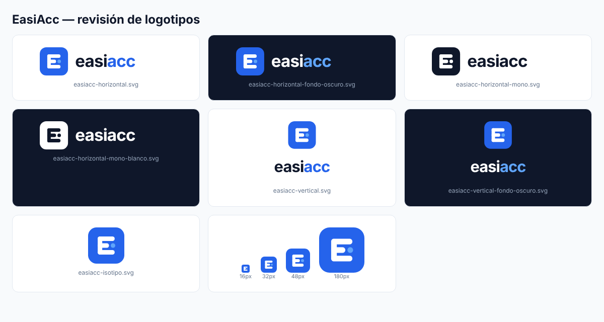

# Manual básico de identidad visual — EasiAcc

**Marca:** EasiAcc · **Producto:** EasiAcc Events · **Eslogan:** *Simplifica tu negocio.*
**Eslogan secundario:** *Una plataforma. Infinitas posibilidades.*

> Estado: identidad inicial para el lanzamiento. El registro de la marca ante el IMPI está pendiente. Se
> recomienda que un diseñador profesional refine el logotipo antes de imprimir material o registrarlo como
> marca mixta.

## 1. Nombre

- Se escribe **EasiAcc** (E y A mayúsculas). Nunca «EasyAcc», «Easiacc» ni «EASIACC» en textos.
- En el logotipo la marca aparece en minúsculas: **easi**acc (*easi* en azul marino, *acc* en azul principal).
- Productos: «EasiAcc Events» hoy; a futuro «EasiAcc Business», «EasiAcc POS», etc. (ver roadmap).

## 2. Logotipo

| Archivo (`public/brand/`) | Uso |
|---|---|
| `easiacc-horizontal.svg` | Uso principal sobre fondos claros |
| `easiacc-horizontal-fondo-oscuro.svg` | Sobre azul marino u oscuros (sidebar, presentaciones) |
| `easiacc-vertical.svg` / `-fondo-oscuro.svg` | Espacios cuadrados (redes sociales, portadas) |
| `easiacc-isotipo.svg` | Ícono de app, favicon, avatar de redes |
| `easiacc-horizontal-mono.svg` / `-mono-blanco.svg` | Impresión a una tinta, sellos, fondos fotográficos |

**Isotipo:** una «E» geométrica formada por barras redondeadas (simplicidad y orden) dentro de un cuadrado
redondeado azul; el punto azul claro representa «infinitas posibilidades». No usa elementos exclusivos de
eventos, para servir a cualquier giro.

**Íconos web:** `public/favicon.svg`, `public/favicon.ico` (16/32/48), `public/icons/icon-192.png`,
`icon-512.png` y `apple-touch-icon.png` (180). Manifiesto: `public/site.webmanifest`.

**Reglas:**
- Área de protección: deja alrededor del logotipo un margen igual a la altura de la barra central de la «E».
- Tamaño mínimo: isotipo 16 px (favicon); logotipo horizontal 120 px de ancho.
- No deformar, rotar, cambiar colores fuera de la paleta, añadir sombras ni colocar sobre fondos con poco contraste.
- En la aplicación se usa el componente `app-brand-logo` (`src/app/shared/components/brand-logo/`), no imágenes sueltas.

**Tipografía del logotipo:** los SVG usan texto con la pila `Inter, 'Segoe UI', Roboto, Helvetica, Arial`.
Para impresión o registro de marca, convertir el texto a curvas en un editor vectorial (Figma, Illustrator,
Inkscape).

## 3. Color

| Rol | Hex | Variable CSS |
|---|---|---|
| Azul marino (sidebar, textos principales) | `#0F172A` | `--brand-navy` |
| Azul principal (botones, enlaces, isotipo) | `#2563EB` | `--brand-primary` |
| Azul secundario (acentos) | `#60A5FA` | `--brand-secondary` |
| Fondo general | `#F8FAFC` | `--brand-background` |
| Blanco (tarjetas) | `#FFFFFF` | — |
| Texto secundario | `#64748B` | `--brand-text-muted` |
| Bordes | `#E2E8F0` | `--brand-border` |
| Éxito | `#16A34A` | `--brand-success` |
| Advertencia | `#D97706` | `--brand-warning` |
| Error | `#DC2626` | `--brand-error` |

Las variables están en `src/styles.css`; los valores también en `src/app/core/brand.ts` (`BRAND_COLORS`).

## 4. Tipografía

**Inter** cuando está disponible; si no, la fuente del sistema (`system-ui`, Segoe UI, Roboto). No se cargan
fuentes externas: la política de seguridad de contenido (CSP) de la app solo permite recursos propios.

## 5. Marca de la plataforma vs. marca de cada empresa

EasiAcc es la herramienta; **las empresas clientes conservan su propia identidad** frente a sus clientes:

| Pieza | Identidad principal | EasiAcc aparece como |
|---|---|---|
| Panel, login, correos de la plataforma (invitaciones, contraseña) | EasiAcc | Marca principal |
| Cotizaciones, contratos, comprobantes de pago (PDF) | Empresa (logo y datos de *Configuración de comprobantes*) | «Generado con EasiAcc» discreto en el pie |
| Correos de firma enviados al cliente final | Empresa (nombre comercial) | «Enviado mediante EasiAcc» |
| Pantalla pública de firma | Empresa emisora | «Firma electrónica por EasiAcc» al pie |

En el backend, `app/branding.py` centraliza la marca (`BRAND_NAME`, `PRODUCT_NAME`, `BRAND_TAGLINE`,
sobreescribibles por variables de entorno) y `tenant_display_name()` devuelve el nombre comercial de cada empresa.

## 6. Tono de comunicación

Español de México, claro y cercano: frases cortas, verbos de acción («Cotiza», «Firma», «Cobra»), sin tecnicismos.
Tratamiento de «tú». Moneda en MXN con formato `$1,499.00`.
